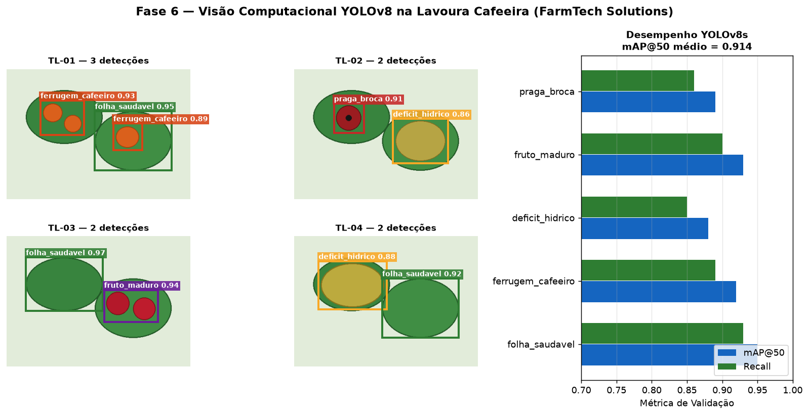

# FIAP - Faculdade de Informática e Administração Paulista

<p align="center">
  <a href="https://www.fiap.com.br/"></a>
</p>

<br>

# 📌 FarmTech Solutions — Fase 6: Colheita de Soluções Inteligentes (Visão Computacional com YOLOv8)

[](https://www.python.org/)
[](https://ultralytics.com/)
[](LICENSE)

## 👨‍🎓 Integrantes
- [Jeliel Cardoso](https://www.linkedin.com/in/jelielcardoso/) — **RM572665**
- [Denis Paulo Dias da Silva](https://www.linkedin.com/in/denispaulodiassilva/) — **RM573278**
- [Deweyne Reuel](https://www.linkedin.com/in/deweyne-reuel-0695522a8/) — **RM573755**

## 👩‍🏫 Professores
### Tutor(a)
- [Sabrina Otoni](https://www.linkedin.com/in/sabrina-otoni-22525519b/)
### Coordenador(a)
- [André Godoi](https://www.linkedin.com/in/andregodoichiovato/)

---

## 📖 Descrição

Na **Fase 6 (Colheita de Soluções Inteligentes)** implementamos o subsistema de **Visão Computacional com YOLOv8** para inspeção fitossanitária automatizada dos talhões de café da **FarmTech Solutions**.

O detector analisa imagens das folhas e frutos coletadas em campo e identifica 5 classes:
- `folha_saudavel` (Operação normal)
- `fruto_maduro` (Planejamento de colheita seletiva)
- `deficit_hidrico` (Severidade MÉDIA — cruzar com sensores de umidade do solo)
- `ferrugem_cafeeiro` (*Hemileia vastatrix*, Severidade ALTA — controle fungicida imediato)
- `praga_broca` (*Hypothenemus hampei*, Severidade ALTA — manejo integrado de pragas)

As detecções são gravadas em `reports/deteccoes_recentes.json`, alimentando diretamente a **Dashboard Integrada** e o **Serviço de Mensageria AWS SNS** na Fase 7.

<p align="center">
  
</p>

---

## ⚙️ Como Executar

```bash
pip install -r requirements.txt
python -m src.detector_lavoura --demo
pytest -q
```

---

## 📄 Licença

Distribuído sob a licença [MIT](LICENSE).
